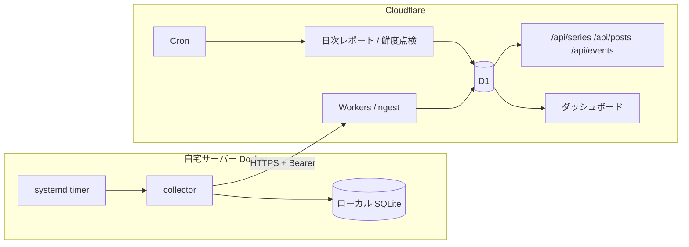

# sns-follower-tracker

複数の SNS アカウントのフォロワー数と投稿ごとの指標を定期取得し、Cloudflare (Workers + D1) に蓄積して推移を見られるようにするトラッカー。

## 概要

SNS 運用では「フォロワーがいつ増減したか」「どの投稿が伸びたか」を後から振り返りたくなりますが、公式の画面では他アカウントを含めた時系列を一覧しにくく、履歴も残りません。

このリポジトリは次のように解決します。

- 自宅サーバー上の Python 製 collector が 1 日数回、フォロワー数と最新投稿の公開指標を取得する (Instagram の住宅 IP 以外からの取得はブロックされやすいため、取得だけは自宅側で行う)
- 取得結果は collector のローカル SQLite に必ず記録(バックアップ兼 outbox)し、同時に Cloudflare Workers の `/ingest` へ送る
- Workers (Hono) + D1 がデータを保持し、ダッシュボード・API・日次レポートを提供する

collector と worker の境界は HTTP API だけで、互いのコードには依存しません。

## 主な機能

- フォロワー数の時系列取得とグラフ・表表示(複数アカウント)
- 投稿ごとの指標(いいね・コメント・再生数など)の取得と一覧
- 管理しているアカウントは公式 Instagram Graph API でリーチ・保存数などのインサイトも取得
- プラグイン式の取得機構 (`platforms/`: Instagram 未ログイン取得 / Instagram Graph API / YouTube)
- 急変動や取得停止を「イベント」として D1 に保存し、ダッシュボード表示と `GET /api/events` で外部提供。通知チャネルのアダプタ (Discord / LINE / Teams) を用意
- 日次レポートと分析(前期間比較・トレンド・成長予測・コンテンツのテーマ別集計・オーディエンス表示)。講評は Workers AI で生成し、設定で Anthropic API に切り替え可能
- 取得時の礼儀ルール(ばらつき付き待機、全滅時の即中断、リトライ最大 1 回)

## 技術スタック

| 領域 | 使用技術 |
|------|----------|
| collector | Python 3.12+ / uv / curl-cffi / httpx / SQLite / Docker / systemd timer |
| worker | TypeScript / Hono / Cloudflare Workers / D1 / Cron Triggers / Workers AI |
| テスト | pytest (pytest-asyncio, respx) |
| CI/CD | GitHub Actions (Worker は Cloudflare へ、collector は rsync + ssh で配備) |

## アーキテクチャ



## セットアップと起動

前提: Node.js、Python 3.12+、[uv](https://docs.astral.sh/uv/)、Cloudflare アカウント。

### worker

```bash
cd worker
npm install
npm run db:migrate:local     # ローカル D1 にマイグレーション適用
npm run dev                  # wrangler dev
npm run typecheck
npm run db:migrate:remote    # 本番 D1 へ適用
npm run deploy
```

### collector

```bash
cd collector
uv sync
uv run pytest                                  # 実ネットワークを使わないテスト
uv run python -m collector.main --dry-run      # モック値でローカル保存のみ
cp .env.example .env                           # WORKERS_BASE_URL / INGEST_SECRET などを設定
uv run python -m collector.main                # 本番相当(実取得・送信)
```

本番は Docker Compose + systemd timer (`deploy/systemd/`) で定期実行します。GitHub Actions の設定は [docs/ci-cd.md](docs/ci-cd.md)、設定値は `<your-subdomain>` などのプレースホルダを自分の環境の値に置き換えてください。

## ディレクトリ構成

```
collector/        Python 取得器 (src/collector/platforms がプラグイン、tests と fixtures)
worker/           Hono + D1 (src/routes, src/lib, migrations/0001〜0009, public)
scripts/          運用スクリプト (ローカル SQLite から D1 を復旧する等)とそのテスト
deploy/systemd/   collector の timer / service
docs/             実装計画書・各機能の計画書・CI/CD 手順
.github/workflows Worker / collector のデプロイ
CLAUDE.md         Claude Code 向けプロジェクト指示
```

## Claude Code での開発

このリポジトリは Claude Code と「計画 → 実装 → 検証」の順で作りました。

- **計画**: [docs/implementation-plan.md](docs/implementation-plan.md) に設計判断(取得場所、保存先、頻度、ログイン方針など)を決定事項として先に確定。機能追加ごとに計画書も書いている (`dashboard-v3-plan.md`、`dashboard-v4-plan.md`、`insights-reports-plan.md`、`insights-v9-plan.md` など)
- **CLAUDE.md**: 「実装前に計画書を読む」「決定事項を勝手に再解釈しない」「取得の礼儀ルールを守る」「パース処理には固定フィクスチャのテストを付ける」といった規約を記載
- **実装**: worker と collector は境界が HTTP API だけなので、独立したパーツとして分担して進められる構成
- **検証**: collector には HTML/JSON の固定フィクスチャによるパーステスト、`/ingest` の統合テスト、トークン更新・取得対象選択などの pytest がある。引き継ぎメモ ([docs/handoff-2026-07-17.md](docs/handoff-2026-07-17.md)) には、Workers AI のレスポンス形状の不一致という不具合の原因調査と修正の経緯、検証で見つけたバグ(目標達成済みの表示が逆になる問題)の修正を記録している

## ライセンス

未定
